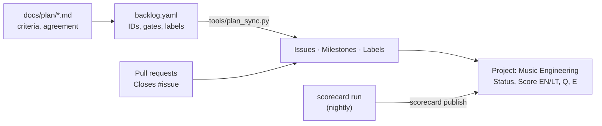
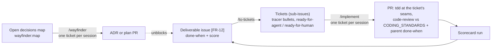

# The plan

| Document | What it decides |
| --- | --- |
| [PRD](prd.md) | Problem, goals, requirements FR-1 to FR-19, architecture, milestones, risks and decisions |
| [Definition of Done](dod.md) | User actions U1–U18 and V1–V11, instrument families, voice pipeline, per-change, per-requirement, per-gate and v1 criteria |
| [Deliverable Scorecard](scorecard.md) | How every deliverable is scored 0–100 per language (quality × approved evidence), and the registry of what is scored |
| [Gold Data Sourcing](sourcing.md) | How test songs and sheet music are found, validity-scored and approved by musicians (FR-16, R1–R10) |
| [Units and Batch Alignment](alignment.md) | The unit ladder L0–L10, batch alignment, improvisation, timing truth, loops and mixes (FR-17–FR-19, M1–M8) |
| [Original brief](brief/audio-reverse-engineering-project-brief.pdf) | The input this plan was built from |
| [PDF snapshots](pdf/) | The plan as exported on 2026-10-18 |

## How the plan is tracked on GitHub

| GitHub feature | Used for |
| --- | --- |
| **Milestones** | One per gate: Gate 0 Foundation and spike → Gate 3 Synth matching, editing and UI. A gate closes when its DoD checklist is ticked |
| **Issues** | One per deliverable, titled `[ID] …`: requirements (FR), instrument families (F-…), user actions (U, V, R, M), enabling tasks (T0-…) and open decisions (D-…). The body carries the done-when criteria copied from the plan |
| **Labels** | Deliverables: `type:*`, `area:*`, `lang:en` / `lang:lt`, `priority:must/should/could`, `agreement:proposed/agreed/changed`. Tickets: `ready-for-agent` / `ready-for-human`. Decision map: `wayfinder:*` only |
| **Project board** | *Music Engineering*: work status (Todo, In progress, Done) plus number fields Score EN, Score LT, Score (any), Quality Q, Evidence E, filled by the scorecard |
| **Pull requests** | Every change; the template carries the DoD every-change checklist. Use `Closes #N` only when the deliverable's evidence is committed |
| **Actions** | CI runs the hermetic tiers of `audiocore` and `remix_studio` on every PR |

**Agreement vs status.** Whether a row is *agreed* is decided in the plan (edit the Status column in a PR, then update the issue's `agreement:` label). Whether it is *being worked on or done* is tracked on the board.

**Adding or changing a deliverable.**

1. Edit the plan doc (criteria) and `backlog.yaml` (ID, gate, area) in one PR.
2. After merge, run `uv run --no-project --with pyyaml python tools/plan_sync.py --project "Music Engineering"`. It creates whatever is missing and leaves existing issues alone. Use `--dry-run` to preview.
3. If an existing criterion changed, update that issue's body in the same PR description.

`issues.json` maps each deliverable ID to its issue number; the scorecard registry uses it to publish scores.

## How work is executed

Three issue kinds, three loops. Terms are defined in [`GLOSSARY.md`](../../GLOSSARY.md); every change is reviewed against [`CODING_STANDARDS.md`](../../CODING_STANDARDS.md). The slash commands are skills from the Matt Pocock skills plugin, run once per repo with `/setup-matt-pocock-skills`.

| Issue kind | Created by | Labels | Loop | Closed when |
| --- | --- | --- | --- | --- |
| **Decision ticket** (sub-issue of the *Open decisions* map) | `plan_sync.py` or `/wayfinder` | `wayfinder:research` / `prototype` / `grilling` / `task` only | Claim it by assigning yourself, resolve it in one session, post the answer as a comment, close it, add one line to the map's *Decisions so far*. Hard-to-reverse answers also get an ADR | The decision is recorded |
| **Deliverable** (`[ID] …`) | `plan_sync.py` from `backlog.yaml` | `type:*`, `area:*`, `lang:*`, `priority:*`, `agreement:*` | When it is picked up and unblocked, run `/to-tickets #<issue>` to slice it into tickets. Never label a deliverable `ready-for-agent` | Its score is 100 in each of its languages, and a person closes it |
| **Ticket** (sub-issue of a deliverable) | `/to-tickets` | `ready-for-agent` or `ready-for-human` | `/implement #<ticket>`: one ticket per fresh session, tests at the seams named in the ticket, `code-review`, commit, PR with `Closes #<ticket>` | Its PR merges |

Rules that keep the loops honest:

- **Slice late.** A deliverable is sliced into tickets only when work on it starts, so tickets reflect what earlier tickets taught us. Prefactoring goes first; a wide refactor uses expand–contract.
- **Seams in the ticket.** Each ticket names its test seams (usually one) and its acceptance checks, copied from the parent's done-when, so `/implement` can run without stopping to ask.
- **One ticket per session**, a fresh context each time (`/clear`). Never two `/implement` runs in one checkout.
- **Evidence, not code, closes deliverables.** `/implement` never closes a deliverable; the scorecard run decides when it reaches 100.
- **Durable state lives in GitHub and the repo** (issues, comments, ADRs, `GLOSSARY.md`), not in chat or temporary handoff files.
