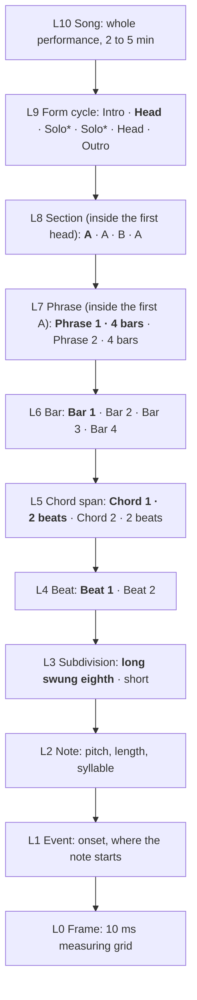

# Audio Reverse Engineering: Units and Batch Alignment

As of 2026-10-18 · Owner: Antanas · Status: living document. Changes go through pull requests. Requirements: FR-17, FR-18 and FR-19 in the [PRD](prd.md).

A recording is aligned to its sheet music in batches, unit by unit, never as one whole. Units nest from a 10 ms frame up to the whole song. Each unit is matched inside its parent, gets its own confidence and a mode (written or improvised), and can then be looped, searched and mixed.

## The unit ladder

Illustrative route of a swing tune; each row zooms into the bold unit above. Solos (*) are improvised, so they are judged only from chord span upwards and are never counted as wrong notes.

## Units in detail

Typical lengths are for a 4/4 swing tune at 150 bpm, like *Grikiai* (one beat = 0.4 s, one bar = 1.6 s).

| Level | Unit | What it is | Typical length | Boundary found by | Compared on |
| --- | --- | --- | --- | --- | --- |
| L0 | Frame | The measuring grid, not a musical unit | 10 ms | Fixed | Pitch, chroma, loudness, onset strength |
| L1 | Event | A note start, drum hit or syllable onset | 20–200 ms | Onset detection per stem | Onset time |
| L2 | Note | One pitch with a duration (and its syllable, for voice) | 0.1–2 s | Onset + offset + pitch change | Pitch, start, length, syllable |
| L3 | Subdivision | Position in the beat: straight or swung eighths, triplets | 0.13–0.2 s | Tempo map + onset positions | Swing ratio, feel |
| L4 | Beat | The pulse; anchors the tempo map | 0.4 s | Beat tracking, checked against the sheet's meter | Beat time |
| L5 | Chord span | How long one chord lasts (harmonic rhythm) | 2 beats to 2 bars | Chroma and bass changes, the sheet's chord symbols | Chord name, function |
| L6 | Bar | One measure of the meter | 1.6 s | Downbeat tracking | Bar time, meter |
| L7 | Phrase | A melodic sentence or lyric line | 2–8 bars | Rests, cadences, breaths, lyric lines | Melody contour, lyric line |
| L8 | Section | Intro, A, B, bridge, solo, outro | 8–16 bars | Repetition, harmony and texture changes; rehearsal marks | Section label, chord sequence |
| L9 | Form cycle | One pass through the tune's form; a jazz “chorus” | 32 bars for AABA | Return to the form's first chords | Form, order of sections |
| L10 | Song | The whole performance: head, solos, head | 2–5 min | File | Arrangement |

Every level above L0 is a container for the level below it, so each note knows its beat, chord, bar, phrase, section and chorus.

## Batch alignment

We never align a whole recording against a whole sheet in one pass. Alignment runs **top-down in batches**: each unit is matched to its counterpart on the sheet, then the units inside it are aligned within that window. A mistake stays inside the unit where it happened.

1. **Form (L9–L10).** Find which form cycles and sections the recording plays, and in what order. The recording may repeat the head, add solo choruses, cut a section or follow D.S. and coda marks differently from the sheet. The result is a *route*, such as “Intro, A A B A (head), A A B A (solo) × 2, A A B A (head), Outro”.
2. **Sections and phrases (L7–L8).** Align each section on the route to its sheet section using harmony and melody features, independently of the others.
3. **Bars and chord spans (L5–L6).** Inside each section, place downbeats and chord changes.
4. **Beats and subdivisions (L3–L4).** Inside each bar, place beats and measure the swing.
5. **Notes and events (L1–L2).** Inside each beat window, match notes and syllables, only where the unit is written (next section).

**Each unit carries its own result:** sheet reference (bars m–n), audio start and end, alignment confidence, mode, key, chords and local tempo. These records form a *unit index* per job, stored with the job manifest. A low-confidence unit is flagged for review without pulling its neighbours down.

**Scoring by level.** Metrics are computed level by level: section-order accuracy, section, phrase and bar boundary error, chord-span accuracy, beat error, and note F-measure. The scorecard shows each level separately, so it's visible whether the app understands the form but misses notes, or the other way round.

## Improvisation

In jazz swing, the sheet fixes the form and the harmony, but players are free inside it. Every unit from phrase up is therefore given a **mode**, which decides the lowest level it is judged at.

| Mode | What happens | Judged down to | Not counted as error |
| --- | --- | --- | --- |
| Written | The melody is played or sung as notated | L2 notes | Timing feel within the tempo map |
| Embellished | The written melody with ornaments, anticipations, rephrased rhythm | L2 notes, with wider timing tolerance and skeleton matching (main notes on strong beats) | Added grace notes, slides, delayed or anticipated entries |
| Improvised | A solo, scat or ad-lib over the form; notes not on the sheet | L5 chord spans (harmony fit, meter, form) | Every note that fits the harmony |
| Comping | Accompaniment rhythm and voicings chosen by the player | L5 chord spans and L3 feel | Voicing and rhythm choices |

- **Where the mode comes from.** First from the sheet: solo sections, slash notation and chord-only bars mean improvised or comping. Otherwise it's detected: high chord agreement but low note agreement means improvised. A musician can confirm or change it.
- **What the app still delivers for improvised units.** The full performance transcription (every note it hears) without a score truth to grade it. Notes are graded only on how well they fit the chords (chord-tone ratio) and the meter.
- **Note F-measure is computed only over written and embellished units.** An improvised solo can't lower note accuracy, and it can't inflate it either.

## Independent timing truth

If gold timings come from aligning the sheet to the recording, and the app is graded with a similar alignment, both make the same mistakes and timing scores look better than they are. Four rules keep the two apart.

1. **One fully timed benchmark song per language.** A musician marks every bar downbeat and every sung word by ear (tap along, then correct), with no software suggestion shown first. This is the independent reference for beat, note and word timing.
2. **Derived timings count fully only from bar level up.** Timings derived by aligning a sheet to a recording, then spot-checked, count fully for bars, phrases and sections (L6–L9). Below bar level (beats, notes, words) they count half, permanently. Only fully timed songs give full evidence there.
3. **Gold is never made with the app's aligner.** Gold derivation uses a separate, frozen score-follower with different features, and its output is corrected by the musician.
4. **Spot-checks include unannounced points.** Besides planned anchors (phrase starts, one per 4 bars), the musician checks 10 random positions per song, so drift between anchors gets caught.

The report shows timing metrics for benchmark songs and derived songs side by side. If they disagree by more than 20 ms in median, the derived timings are treated as unreliable until reviewed.

## Loops and mixes

Once units are aligned with confidence, each one becomes a building block: something to loop, export, search for and recombine.

- **Loop candidates** are units from L5 to L9 (chord span, bar, phrase, section, chorus). A loop's quality depends on: start and end on a downbeat, no note sustained across the loop point (or a short crossfade where one is), matching loudness and timbre on both sides of the cut, and alignment confidence.
- **Mix compatibility** between two units, from any songs, is scored on: key (same, or within ±2 semitones of transposition), tempo (within ±8% stretch), meter, chord function (for example ii–V–I), swing ratio, mode, and which stems exist.

| ID | The user can… | Done when | Priority | Status |
| --- | --- | --- | --- | --- |
| M1 | See the unit ladder on the timeline | Lanes for sections, phrases, bars, chord spans and beats, zoomable, with confidence shading | Must | Proposed |
| M2 | Play or loop any unit | Clicking a unit loops it seamlessly, full mix or any stem | Must | Proposed |
| M3 | Export a loop | Stems or mix cut on bar lines; tempo, key and chords in the metadata; true peak ≤ −0.7 dBFS | Must | Proposed |
| M4 | See and change a unit's mode | Written, embellished, improvised or comping shown per unit; changing it re-scores that unit only | Must | Proposed |
| M5 | See where the recording departs from the sheet | The route (repeats, extra choruses, cuts) shown against the sheet; low-confidence units flagged | Must | Proposed |
| M6 | Search the library for units | Filter by level, key, tempo, chords, mode and stem, for example “4-bar ii–V–I in A minor, 140–160 bpm, improvised” | Should | Proposed |
| M7 | Find units that fit a selected one | Ranked by compatibility; each auditions already matched in tempo and key | Should | Proposed |
| M8 | Build a mix from units | Drop units on a timeline; tempo, key and swing match automatically; bounce at true peak ≤ −0.7 dBFS | Should | Proposed |

## Done when

Batch alignment is FR-18 and loops and mixes are FR-19 in the PRD. Both are scored like every other deliverable.

- [ ] Every job stores a unit index from L1 to L10, with sheet reference, audio span, confidence and mode per unit
- [ ] Section order (the route) is correct on all three Lithuanian songs, including repeats and solo choruses
- [ ] Bar boundaries within 50 ms median, and chord spans ≥ 85% correct, against musician-checked songs
- [ ] Note F-measure is computed only on written and embellished units; an improvised solo cannot change it
- [ ] One benchmark song per language is fully timed by a musician
- [ ] M1–M5 pass their walkthroughs; M2 loops play with no audible click on 20 random bar and phrase loops

## Open questions

- [ ] Can the musicians who approved the three Lithuanian songs mark their form route and which spans are improvised? That is the fastest way to ground L8–L9 and the modes.
- [ ] Which of the three songs should be the fully timed Lithuanian benchmark?
- [ ] What is the smallest unit a user may export as a loop: a chord span, a bar, or a phrase?
- [ ] Mixing across songs: are tempo stretch (±8%) and transposition (±2 semitones) the right limits for this music?
