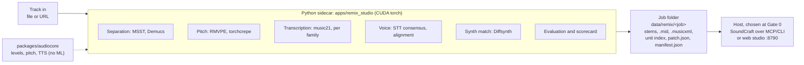

# Audio Reverse Engineering: PRD

As of 2026-10-18 · Owner: Antanas · Status: living document. Changes go through pull requests.

Related: [Definition of Done](dod.md) · [Deliverable Scorecard](scorecard.md) · [Gold Data Sourcing](sourcing.md) · [Units and Batch Alignment](alignment.md) · [Original brief (PDF)](brief/audio-reverse-engineering-project-brief.pdf)

## Readiness

We can start Phase 0. Phase 1 waits for the host decision and a stronger test floor.

| Check | State on 2026-10-18 | Ready? |
| --- | --- | --- |
| Workspace split (ADR 0001, ADR 0002) | This repo holds `apps/remix_studio`, `packages/audiocore`, the plan and `data/` (gitignored). The radio app lives elsewhere | Yes |
| audiocore tests | 17 passed | Yes |
| Remix render fingerprints | `test_render_fingerprints.py` green: engines render bit-identically after the refactor | Yes |
| Remix hermetic test tier | 3 tests pass; 29 more need models or generated data | Thin |
| ML runtime | torch 2.14.1+cpu; the workstation's GTX 1660 (6 GB) is unused | No |
| Foundation decision | The brief assumes a Rust DAW (SoundCraft) as host. Today remix is a Python `http.server` app on port 8790 | Open |

## Summary and problem

We'll turn Remix Studio into an audio reverse-engineering workstation. Drop in a mixed track and get back editable stems, MIDI, a score and matched synth patches, all inside a DAW session. The brief proposes SoundCraft (`storytold/soundcraft`, Rust, MIT OR Apache-2.0, v0.7.0 pre-alpha) as host, with ML work in a Python sidecar driven over its CLI and MCP server.

**Problem.** Today the prototype runs one way, from audio to a rendered recreation, and its outputs are dead ends:

- The stems, MIDI and MusicXML it writes to `data/remix/` can't be edited, auditioned or remixed in one session.
- Synth timbre is hand-modelled. The gap register records sine-oscillator rhythm sections (GAP-02) and muffled vocals (GAP-04, spectral centroid 1226 Hz against 2230 Hz in the original). Nothing estimates synth parameters from the target audio.
- Pitch tracking is librosa/Demucs-era. The brief names stronger trackers: RMVPE for polyphonic vocals and torchcrepe for monophonic stems.
- The only accuracy ground truth is three musician-approved Lithuanian vocal-trio scores (`gold_standards/*.json`), so we can't yet measure how well the pipeline generalises.

Two capabilities decide whether the product works. First, **instrument-aware transcription**: piano, guitar, bass, drums and vocals each need their own analysis and their own notation. Second, **voice understanding**: the app has to know what is being sung or said, transcribe it, and map every word onto the song's structure. The user's acceptance criteria are in the [Definition of Done](dod.md).

**Source.** *Audio Reverse Engineering Project Brief* ([PDF](brief/audio-reverse-engineering-project-brief.pdf)). Its facts about SoundCraft are as of v0.7.0, October 2026, and haven't been checked against the upstream repo.

## Goals, non-goals and success metrics

**Goals**

1. One command turns a mixed track into a DAW session with stems, transcribed MIDI clips, a score and matched instrument patches.
2. Each instrument family has its own transcription and notation logic: piano, guitar, bass, drums and kick, synth, vocals, and SFX.
3. Voice is understood word by word. Lyrics are transcribed, timed to syllables, tied to notes and singers, and editable on the sheet.
4. Every stage writes a versioned artifact and can be rerun on its own, from the CLI or by an agent over MCP.
5. Gold standards from approved professional musicians measure accuracy. Every deliverable carries a 0–100 score per language, and CI fails when a score regresses.
6. The existing studio keeps working throughout. Fingerprints stay green unless a sound change is intended.

**Non-goals for v1**

- Languages other than English and Lithuanian. Both run as parallel tracks; other languages follow later as language packs.
- Local-only processing. Outside STT and TTS services are allowed; a local path comes later.
- In-app legal, rights or consent checks. The user takes full responsibility for lawful use.
- Generative music (DiffSynth-Studio, ACE-Step). Parametric recreation comes first.
- External VST3/AU hosting. v1 targets built-in synths only, because of open issues #599, #600 and #640.
- Strudel or any AGPL code in the distributed build.
- Any change to the radio app or its VPS.

**Success metrics** (thresholds confirmed at Gate 0, once current baselines are measured; voice rows are measured separately for English and Lithuanian)

| Metric | Measured on | v1 target |
| --- | --- | --- |
| Note F-measure (onset ±50 ms, pitch ±50 cents) | Gold songs, per instrument family, written units only | Baseline + 15 points |
| Drum hits (kick, snare, hi-hat) onset F-measure | Gold drum stems | ≥ 0.85 each |
| Bass octave errors | Gold bass stems | < 5% of notes |
| Lyrics word error rate (EN and LT, each) | Gold lyrics | Baseline − 30% relative |
| Word-boundary error, median | Gold word-timed lyrics (timed by ear) | ≤ 80 ms |
| Syllables on the right note | Gold songs | ≥ 90% |
| Vocal stem SDR | Gold reference stems | ≥ current Demucs 6s result |
| Synth-match win rate (MR-STFT loss vs hand-modelled timbre) | Held-out synth stems | ≥ 80% of clips |
| Track to session, wall clock | 3-minute song on the GTX 1660 | ≤ 10 min |
| True peak on every rendered stem and mix | All renders | ≤ −0.7 dBFS |

Every deliverable is also tracked as a 0–100 score per language in the [Deliverable Scorecard](scorecard.md). The score combines quality with approved evidence, and a deliverable is done at 100. Gold data comes from a background sourcing loop with musician approval: see [Gold Data Sourcing](sourcing.md).

## Users and use cases

The main user is the producer and operator: one person working on a Windows workstation. Coding agents are the second user, driving the same commands over CLI and MCP.

| User | Use case | Done when |
| --- | --- | --- |
| Producer | Deconstruct a track into stems, MIDI and a score in one step | The session opens with one track per stem and one MIDI clip per pitched stem |
| Producer | Read each instrument in its own notation | Piano shows a Grand Staff, guitar shows TAB, bass shows bass clef and TAB, drums show a percussion staff |
| Producer | Follow and understand the lyrics | Words highlight as they are sung; lines are tagged by singer and by sung or spoken |
| Producer | Correct the lyrics and their timing on the sheet | Retyping, dragging or splitting a word updates playback and exports at once |
| Producer | Recreate a stem with a matched synth patch, then A/B it against the original | The matched patch plays from a built-in synth, with its loss shown next to the original |
| Producer | Loop, search and mix units (bars, phrases, choruses) | Any aligned unit loops cleanly and can be combined with compatible units from other songs |
| Producer | Remix: mute, solo or replace layers, then bounce | Bounce writes WAV/FLAC with true peak ≤ −0.7 dBFS |
| Approved musician | Provide gold-standard scores and word-timed lyrics | Files are stored with author and approver; only approved files count toward metrics |
| Coding agent | Run the pipeline headless and check the output | `ai.deconstruct_and_match` returns structured results or typed errors, and never crashes |
| Maintainer | Catch accuracy regressions | CI fails when a gold-standard metric or score drops past tolerance |

## Functional requirements

The Python sidecar (work package A) is `apps/remix_studio` grown into a service. The brief's `services/ml-sidecar/` doesn't become a separate app. Each stage reads and writes files under `studio_paths.DATA_DIR` and records them in a per-job manifest.

| ID | Stage | Requirement | Replaces / extends | Priority |
| --- | --- | --- | --- | --- |
| FR-1 | Ingest | Accept a file or URL. Resample to 48 kHz and write a job manifest with input hash, model versions and any outside services used | `ingest_song.py` | P0 |
| FR-2 | Separation | Write phase-aligned 48 kHz stems (vocals, bass, drums, synth/other, sfx) with ZFTurbo MSST (BS-RoFormer / Bandit Plus), plus a lead/backing vocal split; keep Demucs 6s as fallback | `layer_discovery.py` | P0 |
| FR-3 | Pitch | Frame-level F0 and confidence: RMVPE for vocals and polyphonic leads, torchcrepe for monophonic stems, a low-range tracker for bass (down to 30 Hz) | `audio_to_midi.py` | P0 |
| FR-4 | Transcription | Turn F0 and onsets into notes using each instrument family's logic; write `.mid` and family-specific `.musicxml` | `polyphonic_transcriber.py`, `sheet_music_exporter.py` | P0 |
| FR-5 | Structure | Extract section boundaries, beats and chords as markers | new | P1 |
| FR-6 | Synth matching | Estimate normalised [0, 1] parameters for a built-in synth from a stem, using a Diffsynth-style estimator and auraloss MR-STFT loss; return the top N candidates with their loss | `acoustic_timbre_engine.py` | P1 |
| FR-7 | Session assembly | Create audio tracks per stem, instrument tracks with MIDI clips and the matched patch, lyric and marker lanes, as one batch that reports partial failures | new (WP-B) | P0 if SoundCraft is adopted |
| FR-8 | Score view | Render each family's notation, with lyrics under the vocal staff, in sync with the playhead | `static/` | P1 |
| FR-9 | Evaluation | Score every job against approved gold standards when one exists; persist per-family and voice metrics in the SQLite catalog | `accuracy_evaluator.py`, `gold_standard_benchmark.py` | P0 |
| FR-10 | Interfaces | Every stage callable from CLI and over JSON (HTTP now, MCP once a host exists), with typed errors | `server.py` | P0 |
| FR-11 | Instrument families | Label each stem with a family (piano, guitar, bass, drums/kick, synth, vocals, sfx), automatically or by the user; the label selects transcriber, notation and checks. Guitar gets string and fret assignment, drums get hit classification on a GM drum map, piano gets hand split and pedal | new | P0 |
| FR-12 | Voice understanding | Detect sung, spoken and rap segments and language; transcribe with several STT engines (cloud allowed) into a consensus with per-word confidence; force-align words, syllables and phonemes; tie syllables to notes and lines to singers. English and Lithuanian in parallel | `vocal_transcriber.py`, `experiments/stt_tournament.py` | P0 |
| FR-13 | Lyric editing | Edit word-timed lyrics on the sheet: retype, move to another note or time, split or merge syllables, change melismas, with undo; edits survive reprocessing of other stems | new | P0 |
| FR-14 | Re-voicing | Re-sing or re-speak a line with TTS, a singing-voice synth or voice conversion (cloud allowed), keeping melody and timing | `singing_tts_engine.py`, `neural_singing_synthesizer.py` | P1 |
| FR-15 | Gold provenance | Every gold file records author and approving professional musician; unapproved files are excluded from metrics | `gold_standard_parser.py` | P0 |
| FR-16 | Gold data sourcing | A background worker finds music, sheet music, MIDI and timed lyrics for scorecard gaps; aligns each candidate to its audio; gives it a validity score (0–100) from 8 signals; and surfaces it for user triage and musician approval. Spec: [sourcing.md](sourcing.md) | new | P0 |
| FR-17 | Score and performance | Every transcription stores two layers and the link between them: the performance (what sounds, in seconds), the score (what would be written, in bars and beats) and a tempo map with per-note offsets. Notation shows the score layer; playback and highlighting use the performance layer. Expression (timing feel, swing, slides, ornaments) is kept, not counted as error; consistent deviations can be marked as performed variants | new | P0 |
| FR-18 | Batch alignment | Align recording to sheet top-down in units, never whole song to whole sheet: route (form cycles, sections, repeats, extra choruses) first, then sections, phrases, bars, chord spans, beats and notes, each inside its parent with its own confidence. Every unit from phrase up has a mode (written, embellished, improvised, comping) that sets the lowest level it is judged at. Stores a unit index per job. Spec: [alignment.md](alignment.md) | new | P0 |
| FR-19 | Loops and mixes | Any aligned unit from chord span to chorus can be looped and exported per stem; units are searchable by level, key, tempo, chords and mode; compatible units across songs are ranked and auto-matched in tempo, key and swing for building mixes | `multi_genre_engine.py`, `jungle_remix_engine.py` | P1 |

## Architecture fit and non-functional requirements

The brief fits our rules if SoundCraft sits outside the Python app as a vendored host. Nothing ML goes into `audiocore`.

The job folder is the contract between the two sides, so the host decision can change without touching the ML code.

- **Boundaries.** ML dependencies stay in `apps/remix_studio`. `audiocore` stays numpy/scipy/soundfile.
- **Host placement.** If adopted, SoundCraft is a pinned fork under `vendor/soundcraft` or a sibling repo. It talks to the sidecar only through files in the MCP read and write roots, plus CLI/JSON. No Rust–Python FFI.
- **Per-family modules.** Each instrument family is a transcriber + notation module behind one interface, so families can be added or tuned on their own.
- **Outside services.** Cloud STT and TTS are allowed in v1, behind one adapter per service. Keys come from the environment, never the repo. Each job records service, model and version. A network or quota failure is a typed error, and the stage can be rerun. A local-only path is a later goal.
- **Paths.** Every location comes from `studio_paths.py`.
- **Determinism.** Seeded renders. Model weights pinned by hash in the job manifest. Fingerprint tests cover every engine that produces sound. Cloud results are cached per job so reruns don't change them.
- **Robustness.** Hostile input rejected with typed errors at each stage: NaN, out-of-range values, corrupt files.
- **Realtime safety.** Inference never runs on an audio thread.
- **Performance.** Uses the GTX 1660 (6 GB): CUDA torch wheels, fp16 where supported, chunked separation so peak VRAM stays under 5 GB. The CPU path stays working.
- **Headroom.** True peak ≤ −0.7 dBFS (`audiocore.dsp.true_peak_dbfs`) on every bounce.
- **Legal use.** The user is responsible for lawful use of input audio and voices, and the terms of use say so. The app adds no rights or consent checks.
- **Licensing of our build.** Code allowlist: MIT, BSD, Apache-2.0. Strudel (AGPL-3.0) is excluded. Diffsynth's licence must be confirmed before any distributed use.
- **Testing.** The hermetic tier gets at least one test per stage and per family, using tiny fixtures, stub models and recorded cloud responses. The `slow` tier runs real models and live services.

## Milestones

Four phases, each closed by a measurable gate. No dates yet: Phase 0 produces the estimates. Each gate is a GitHub milestone; each deliverable is an issue (see [docs/plan/README.md](README.md)).

```mermaid
flowchart TB
    P0["<b>Phase 0 · Foundation and spike (now)</b><br/>CUDA torch on the GTX 1660; one hermetic test per stage with stub models<br/>Sourcing worker v0: first EN and LT candidates scored, review queue live (FR-16)<br/>Scorecard first; SoundCraft spike; EN and LT STT tournaments; musicians start gold sets"]
    G0{{"Gate 0: host decision as ADR; scorecard baseline stored for EN and LT"}}
    P1["<b>Phase 1 · Sidecar upgrade (WP-A)</b><br/>MSST separation, per-family pitch and transcription, family notation (FR-1 to FR-4, FR-11)<br/>EN and LT voice: STT consensus, alignment, syllables on notes; scored in CI (FR-9, FR-12)<br/>Score/performance layers and batch alignment (FR-17, FR-18)"]
    G1{{"Gate 1: note F-measure at least baseline + 15; fingerprints green"}}
    P2["<b>Phase 2 · Session assembly (WP-B)</b><br/>ai.deconstruct_and_match: stem tracks, MIDI clips, markers in one batch (FR-5, FR-7)<br/>If SoundCraft is rejected: the same output as a session folder plus web player"]
    G2{{"Gate 2: a 3-minute song becomes a session in 10 minutes or less"}}
    P3["<b>Phase 3 · Synth matching, editing and UI (WP-C)</b><br/>Diffsynth-style estimator for one built-in synth, top-N candidates with loss (FR-6)<br/>Lyric editing on the sheet, re-voicing, score view with sync, loops and mixes (FR-8, FR-13, FR-14, FR-19)"]
    G3{{"Gate 3: every v1 Must deliverable scores 100 in EN and LT, v1 done"}}
    P0 --> G0 --> P1 --> G1 --> P2 --> G2 --> P3 --> G3
```

Phase 1 is worth doing whatever the host decision is. Phase 2 has a fallback, so a rejected SoundCraft doesn't stop the project.

## Risks and open questions

| Risk | Impact | Mitigation |
| --- | --- | --- |
| SoundCraft is pre-alpha (~40% Pro Tools parity, export stalls #624/#665) | Session assembly breaks under us | Pin a version. Keep the sidecar usable on its own (files + HTTP). Gate adoption on the Phase 0 spike |
| The brief's claims about SoundCraft are unverified | We plan around commands or PRs that don't exist | The Phase 0 spike checks every command the PRD relies on |
| Sung lyrics are much harder for STT than speech | Word error rate stays high; alignment drifts | Several engines plus consensus, run on the isolated lead vocal; manual editing on the sheet (FR-13) as the safety net |
| Dependence on cloud STT/TTS | Cost, rate limits, outages, service changes | Adapter per service, cached results, at least two engines per stage; local path later |
| 6 GB VRAM | RoFormer/Bandit models and Diffsynth training run out of memory | Chunked inference, fp16, smaller checkpoints. Train synth matchers on a rented GPU if needed |
| Gold standards depend on approved professional musicians | Bars can't be frozen until enough songs exist (≥ 8 songs per language, ≥ 3 clips per family) | Start musicians now on both languages; the scorecard tracks evidence coverage; the sourcing worker keeps their review queue full |
| Guitar and piano polyphony | Wrong voicings, unplayable TAB | Family-specific models; playability check on TAB; per-family bars |
| Grading the app against its own timing | Timing scores look better than they are | Below bar level only songs timed by ear count fully; gold never made with the app's aligner ([alignment.md](alignment.md)) |
| Upstream trademark terms | Fork distribution violates `LICENSE-brand.txt` | Strip branding before any shared build |

**Open questions** (each is a ticket on the *Open decisions* map issue, resolved one per session with `/wayfinder`)

- [ ] Adopt SoundCraft as host, or keep the Python studio plus a web UI and add a DAW later? (Decided at the end of Phase 0)
- [ ] Native egui panel (Path A) or browser hybrid with OSMD (Path B)?
- [ ] Which built-in synth does matching target first, and what's its exact parameter list?
- [ ] Which cloud STT and TTS services go into the first tournament?

**Decisions (2026-10-18)**

| Topic | Decision |
| --- | --- |
| Languages | English and Lithuanian as parallel tracks from the start; other languages later as language packs |
| Outside services | Audio may go to cloud STT/TTS now; a local-only path comes later |
| Legal use | The user takes full responsibility for using the tool legally; no in-app checks |
| Gold standards | Only approved professional musicians provide gold-standard sheet music and lyrics. The three Lithuanian songs (*Grikiai*, *Virusas*, *Prie Topolio*) are musician-provided and approved |
| Lyric editing | The user can edit word-timed lyrics manually on the sheet |
| Instrument logic | Each instrument family gets its own transcription and notation; voice gets its own pipeline |
| Progress tracking | Every deliverable is scored 0–100 per language (quality × approved evidence) and tracked over time; the scorecard is built first, in Phase 0 |
| Gold data sourcing | A background worker finds and validity-scores candidate songs and scores; users triage, approved musicians approve; nothing becomes gold without approval |
| Score vs performance | Sheet music is prescriptive, not a timestamped record. Gold songs keep an approved score layer; timing truth is derived by aligning it to the recording and spot-checked by a musician |
| Batch alignment and improvisation | Recordings are aligned to sheets in units from frame to song, not as a whole; improvised units (jazz solos) are judged at chord level, not note level. Timing below bar level is trusted only from songs a musician has timed by ear (one benchmark per language) |
| Plan and tracking | The plan lives in this repo (`docs/plan/`); work is tracked as GitHub issues, milestones per gate and a GitHub Project ([ADR 0002](../adr/0002-music-engineering-repo.md)) |
