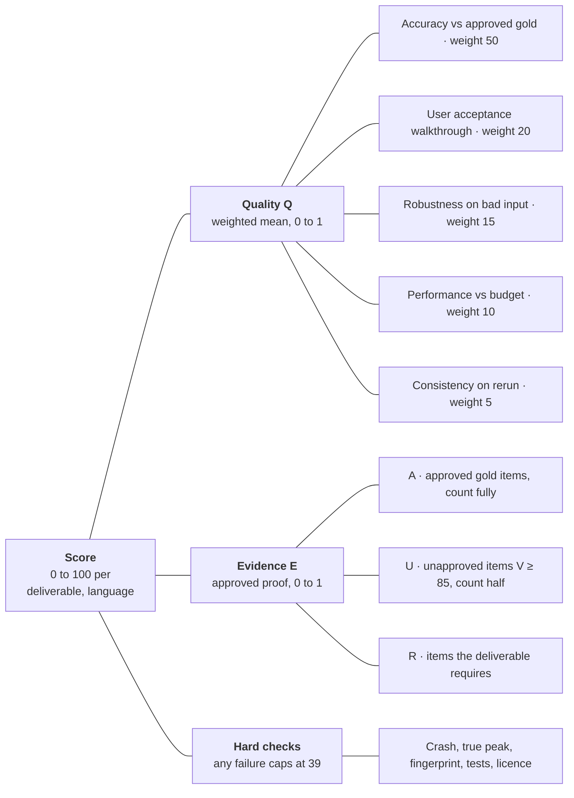

# Audio Reverse Engineering: Deliverable Scorecard

As of 2026-10-18 · Owner: Antanas · Status: living document. Changes go through pull requests.

Every deliverable gets one score from 0 to 100 per language, recomputed on every scoring run. A score of 100 means *done* in the [Definition of Done](dod.md). The same formula applies to every feature, every instrument family and every language, so progress can be compared and tracked over time. Each deliverable's latest Q, E and score are mirrored onto its GitHub issue and the Project board.

## How a score works

A score multiplies how good the deliverable is (**quality**) by how much approved proof stands behind that measurement (**evidence**). It's capped at 39 while any hard check fails.

$$
\text{Score}(d, \ell) = \left\lfloor 100 \cdot Q(d, \ell) \cdot E(d, \ell) \right\rfloor, \quad \text{capped at } 39 \text{ if any hard check fails}
$$

$$
Q = \frac{\sum_c w_c \, n_c}{\sum_c w_c}, \qquad n_c = \operatorname{clamp}\left(\frac{x_c - \text{floor}_c}{\text{target}_c - \text{floor}_c},\ 0,\ 1\right)
$$

$$
E = \min\left(1,\ \frac{A + 0.5\,\min(U, R)}{R}\right)
$$

Here *d* is the deliverable and ℓ the language (“any” for deliverables that don't depend on language). Each component *c* has a raw measurement *x*, a floor that scores 0, a target that scores 1, and a weight *w*. For lower-is-better metrics, such as word error rate, the floor is set above the target and the same formula works. *A* is the number of approved gold items measured, *U* the number of unapproved items, and *R* the number the deliverable needs.

A deliverable reaches 100 only when every component is at or past its target, every required gold item is approved, and no hard check fails. Better-than-target results don't raise the score above 100 or make up for a weak component elsewhere.

## Components

Each deliverable uses the components that apply to it. A missing component isn't counted as zero; it's left out of the weighted mean. Default weights are shown below; a deliverable can override them in the registry, as long as the weights still add up to 100.

| Component | Measures | Raw value x | Floor (scores 0) | Target (scores 1) | Default weight |
| --- | --- | --- | --- | --- | --- |
| Accuracy | How close output is to approved gold | The deliverable's metric: F-measure, word error rate, boundary error, SDR, onset F, and so on. Several metrics are averaged after normalising | Gate 0 baseline, or the “unusable” value when there is no baseline | The DoD target | 50 |
| User acceptance | Whether the user can do the action | Share of walkthrough steps passed, on 2 songs per language | 0% | 100% | 20 |
| Robustness | Behaviour on bad and odd input | Share of edge-case tests passed: corrupt, silent, clipped or very long files, extreme tempo, noise | 0% | 100% | 15 |
| Performance | Speed and memory | Wall clock and peak VRAM against budget | 3× budget | At or under budget | 10 |
| Consistency | Same input, same output | Share of reruns identical (cloud results replayed from cache) | 0% | 100% | 5 |

**Hard checks** (no weight, but any failure caps the score at 39):

- A crash or stack trace on valid input
- True peak above −0.7 dBFS on any render
- An unintended render-fingerprint change
- A failing hermetic test in the deliverable's area
- A dependency or checkpoint outside the licence allowlist

## Evidence and trust

A score only counts as much as the approved data behind it. Evidence *E* is what turns a good-looking number into a trusted one.

- **Gold item.** One song or clip with an approved reference for what the deliverable measures: notes, word-timed lyrics, drum hits, sections or stems.
- **Approval record.** Each gold item stores its author, the approving professional musician (from an approved list), the date, the scope (notes, lyrics, timing) and a checksum of the files. If a file changes after approval, its approval no longer applies.
- **Unapproved items** count half, but only unreviewed candidates with validity V ≥ 85 qualify. They let us track progress before musicians deliver, but they can't take a score past 50.
- **Required amounts** *R*, per language and per deliverable (proposed):

Candidates are found, validity-scored and queued for review by the background loop in [Gold Data Sourcing](sourcing.md).

| Evidence set | Required per language | Applies to |
| --- | --- | --- |
| Songs with word-timed lyrics and melody | 8, across ≥ 2 genres | Voice deliverables (FR-12 to FR-14, V1–V11) |
| Clips per instrument family | 3 | FR-4, FR-11 and each family; not language-specific |
| Songs with sections and chords | 5 | FR-5, U9 |
| Walkthrough songs | 2 (1 gold, 1 not) | Every user action (U, V) |

**Language trust score.** For a language ℓ, it's the mean score of all language-dependent deliverables, with Must items weighted twice. It answers one question: how far can we trust what the app says about audio in this language? Next to it the report shows the language's evidence coverage *E*, so a low score is easy to tell apart from missing data.

**Uncertainty.** Each accuracy value is reported with a 90% bootstrap interval over gold items. The score uses the point value; a wide interval is a signal to add evidence, not a different score.

## Score and performance

A sheet sets out how the music should go; a recording is one performance of it. Singers push and pull the beat, swing straight eighths, add slides and ornaments, and hold notes longer or shorter than written. Neither is wrong, so every song carries two layers, and each check is scored against the layer it is about.

| Layer | Holds | Time unit | Truth comes from | Checks it feeds |
| --- | --- | --- | --- | --- |
| Score | Notes, written durations, meter, chords, voices, lyric syllables per note | Bars and beats | Approved sheet music | Score-level note F, chords, syllables on notes, notation |
| Performance | When each note and word actually sounds; pitch curve; loudness | Seconds | The recording | Word highlighting, word-boundary error, onset error, playback sync |
| Tempo map (the link) | The second each beat falls on, plus each note's offset from its beat | Beat ↔ second | Score aligned to the recording | Places every score item in the recording, and back |

**Timing truth for songs that only have an approved score** (the three Lithuanian songs today):

1. Align the approved score to the recording in batches, unit by unit (see [Units and Batch Alignment](alignment.md)), voice by voice on separated stems, with a score-follower kept separate from the app's own aligner.
2. A musician spot-checks anchor points (every phrase start, at least one per 4 bars, plus 10 unannounced random points).
3. After the spot-check passes (≥ 95% of points within 50 ms, after corrections), derived timings count **fully for bars and above**, and stay at **half for beats, notes and words**. Full timing evidence below bar level comes only from songs a musician has timed completely by ear. Each language needs at least one such benchmark song.

So the three Lithuanian songs count fully for score-level checks, half for bar-level timing until spot-checked, and half for note and word timing until a musician times them by ear. Because they are jazz swing with improvised solos, note-level checks run only on their written and embellished units.

**Expression or error?** Comparing a transcription with the score layer:

| Difference from the written score | Counts as |
| --- | --- |
| Onset off the written grid but consistent with the tempo map | Expression, not an error |
| Swing or dotted feel on written straight notes | Expression; reported as a swing ratio |
| Grace notes, slides, scoops, vibrato not written | Expression, unless held as a new pitch for ≥ 1 beat |
| A different held pitch, a missing note, an extra note | Error |
| A word or note sung differently from the sheet, consistently | Performed variant: flagged for a musician, who can mark it “as performed” so the gold keeps both versions |

## Languages

English and Lithuanian run as parallel tracks, and both are scored from the first run. Every language is a *language pack*: the scoring formula stays the same, and the pack supplies what is specific to the language.

| Pack part | English | Lithuanian |
| --- | --- | --- |
| Text normalisation for word error rate | Lower-case, strip punctuation, spell out numbers | Same, but keep diacritics (ą č ę ė į š ų ū ž), since they change meaning |
| Syllable rules | Dictionary-based hyphenation | Existing `split_into_syllables_lt` in `vocal_transcriber.py`, checked against gold |
| Aligner model | English acoustic model | Multilingual (MMS) or a Lithuanian-trained model |
| STT / TTS candidates | Cloud services, Whisper large-v3 / turbo | Cloud services with Lithuanian support, Whisper, a Lithuanian-tuned model; Edge-TTS `lt-LT` voices |
| Gold set today | 0 items | 3 songs (*Grikiai*, *Virusas*, *Prie Topolio*), provided and approved by musicians |
| Evidence coverage *E* today | 0 | Score-level checks 0.38 (3 approved of 8); bar-level timing 0.19 until spot-checked; note and word timing 0.19 until songs are timed by ear |

**Adding a language** means adding a pack and a gold set; the code and formula stay as they are. Its scores start at 0 and rise as evidence and quality arrive.

**Fastest trust gain now:** English. Lithuanian stands at 0.38 for score-level checks with its three approved songs (word and note timing need songs timed by ear by a musician) and needs 5 more; English has none, so it gets sourcing and commissioning priority.

## Bands and rules

| Score | Band | Meaning |
| --- | --- | --- |
| 0–39 | Not trusted | A hard check is failing, or there's too little quality or evidence to rely on |
| 40–69 | Developing | Works on some material; not to be relied on for real songs |
| 70–89 | Usable | Reliable on most material; known gaps remain |
| 90–99 | Release candidate | Meets nearly every target with approved evidence |
| 100 | Done | Every component at target, full approved evidence, no hard check failing |

**Rules that keep the score honest**

1. **Machines measure, people approve.** Every component except user acceptance is computed by the scoring run. Walkthroughs are recorded with screenshots or video, and the record is linked from the run.
2. **Targets and floors are frozen per release.** Changing one needs a recorded decision with the reason, and old scores are recomputed against the new values so trends stay comparable.
3. **Gold data is never trained on.** Gold items are held out from any model training or tuning, and the scoring run checks their checksums against a training manifest.
4. **Regression blocks merges.** CI fails when any deliverable drops more than 2 points, or when a language trust score drops at all, against `main`.
5. **No rounding up.** Scores are floored to the integer below, so 99.6 shows as 99.
6. **Release rule.** A release ships when every Must deliverable it includes scores 100 in each of its languages. Should and Could items ship at ≥ 70 or are cut.

## Worked example

V1, word highlighting in Lithuanian, scores **12** on today's evidence. Quality is moderate, but V1 is a timing check: the 3 approved songs only have derived timings, so they count half (1.5 of the 8 needed). *All quality measurements below are illustrative; real ones come from the first scoring run.*

| Component | Raw value | Floor → target | Normalised | Weight |
| --- | --- | --- | --- | --- |
| Accuracy: word-boundary error | 170 ms | 300 → 80 ms | 0.59 | 50 (averaged with the row below) |
| Accuracy: word error rate | 34% | 40% → 28% | 0.50 | |
| User acceptance | 7 of 10 steps | 0 → 100% | 0.70 | 20 |
| Robustness | 18 of 20 cases | 0 → 100% | 0.90 | 15 |
| Performance | 12 min | 30 → 10 min | 0.90 | 10 |
| Consistency | 10 of 10 reruns identical | 0 → 100% | 1.00 | 5 |

Quality *Q* = (50 × 0.545 + 20 × 0.70 + 15 × 0.90 + 10 × 0.90 + 5 × 1.00) / 100 = 0.6875. With evidence *E* = 1.5/8 = 0.1875, Score = ⌊100 × 0.6875 × 0.1875⌋ = ⌊12.9⌋ = 12.

- A musician times one of the three songs completely by ear: *E* = (1 + 0.5 × 2) / 8 = 0.25, so the score becomes **17**. A spot-check alone doesn't raise it, because V1 is a word-level check.
- All three timed by ear: *E* = 0.375, score **25**. Eight timed songs: *E* = 1.00, score **68**, with no code change.
- After that, only better quality moves it: the path to 100 is the per-deliverable plan we write next.
- The same deliverable in English scores 0 until its first approved songs arrive, while its Q is already shown.

## Deliverable registry

Every item below is scored and has a GitHub issue. User actions (U, V, R, M) are what the user experiences; requirements (FR) and instrument families (F) are the engineering underneath. Language-dependent items get a separate score for EN and for LT. The next step is to write, for each row, what it takes to reach 100.

| ID | Deliverable | Scored for | Main accuracy metric | Evidence set |
| --- | --- | --- | --- | --- |
| FR-1 | Ingest | any | Manifest completeness | Walkthrough songs |
| FR-2 | Separation | any | Vocal SDR; lead/backing leakage | Gold reference stems |
| FR-3 | Pitch | any | Raw pitch accuracy (±50 cents) | Family clips |
| FR-4 | Transcription | any | Note F-measure | Family clips |
| FR-5 | Structure | any | Section boundary F; chord accuracy | Sections and chords songs |
| FR-6 | Synth matching | any | MR-STFT win rate | Held-out synth clips |
| FR-7 | Session assembly | any | Batch success rate | Walkthrough songs |
| FR-8 | Score view | any | Cursor sync error | Walkthrough songs |
| FR-9 | Evaluation | any | Metric coverage of gold items | All sets |
| FR-10 | Interfaces | any | Contract tests passed | n/a (tests) |
| FR-11 | Instrument families | any | Family label accuracy | Family clips |
| FR-12 | Voice understanding | EN, LT | WER; boundary error; syllables on note | Lyric songs |
| FR-13 | Lyric editing | EN, LT | Round-trip fidelity | Lyric songs |
| FR-14 | Re-voicing | EN, LT | F0 spread vs original | Lyric songs |
| FR-15 | Gold provenance | any | Share of gold with valid approval | All sets |
| FR-16 | Gold data sourcing | EN, LT | V calibration (share of V ≥ 85 approved); gap fill rate | Musician review outcomes |
| FR-17 | Score and performance layers | any | Beat error vs spot-checked anchors; written durations recovered by quantisation | Spot-checked anchors on gold songs |
| FR-18 | Batch alignment (unit ladder L0–L10) | any | Route accuracy; boundary error per level; chord-span accuracy; note F on written units only | Musician-marked routes and modes; benchmark songs |
| FR-19 | Loops and mixes from units | any | Click-free loop rate; compatibility ranking judged by listeners | Walkthrough songs; listening panel |
| F-piano | Piano / keys | any | Note F; hand-split accuracy | 3 piano clips |
| F-guitar | Guitar | any | Note F; playable TAB share; chord names | 3 guitar clips |
| F-bass | Bass | any | Octave errors; onset error | 3 bass clips |
| F-drums | Drums and kick | any | Kick, snare, hi-hat onset F | 3 drum clips |
| F-synth | Synth lead / pad | any | Note F | 3 synth clips |
| F-sfx | SFX / other | any | Event onset F | 3 SFX clips |
| U1–U18 | User actions (see DoD) | any; U5, U6, U8 per family | Walkthrough + the linked FR metric | Walkthrough songs |
| V1–V11 | Voice actions (see DoD) | EN, LT | Walkthrough + FR-12/13/14 metrics | Lyric songs + walkthrough songs |
| R1–R10 | Review actions (see sourcing) | any | Walkthrough | Walkthrough candidates |
| M1–M8 | Loop and mix actions (see alignment) | any | Walkthrough | Walkthrough songs |

## Tracking mechanism

The scorecard is code in `apps/remix_studio/scorecard/`, built in Phase 0 before any feature work, so every later change is measured from day one.

| Part | Where | What it does |
| --- | --- | --- |
| Registry | `scorecard/registry.yaml` | Every deliverable: components, metrics, floors, targets, weights, evidence set, languages, GitHub issue number. Frozen per release tag |
| Language packs | `scorecard/languages/en.yaml`, `lt.yaml` | Normalisation, syllable rules, aligner and engine choices, required evidence |
| Gold approvals | `approval.json` next to each gold item | Author, approving musician, date, scope, SHA-256 of the files |
| Metric providers | One `measure()` per FR and family | Returns raw values per gold item; no scoring logic inside |
| Scoring run | `uv run python -m scorecard run [--only FR-12] [--lang lt]` | Runs providers, applies hard checks, computes Q, E and score |
| History | SQLite `data/remix/db/remix_studio.db`, tables `score_runs` and `scores` | One row per run, deliverable, language and component, with commit hash; never overwritten |
| Walkthroughs | `scorecard/walkthroughs/<release>/<id>-<lang>.json` | Step results plus a link to the recording |
| Report | `uv run python -m scorecard report` | Quality Q, evidence E and score, each shown separately, with change since last run and since `main`, language trust scores, and the weakest component of each deliverable |
| GitHub sync | `uv run python -m scorecard publish` | Writes each deliverable's latest Q, E and score per language to its issue's Project fields |
| CI | Hermetic tier + a nightly run on the workstation GPU | Hermetic: checks the scoring maths on stub data. Nightly: real models and services, regression rule applied |

**Done when** (the scorecard is itself a deliverable, and must score 100 first):

- [ ] The scoring maths has hermetic tests, including this doc's worked example (12 now, 17 with one song timed by ear, 68 with 8)
- [ ] Every registry row has a metric provider, even if the provider only reports “no evidence”
- [ ] The first nightly run stores a baseline for every deliverable in EN and LT
- [ ] The report shows each deliverable's score, its trend and its weakest component
- [ ] A deliberate regression in a test branch makes CI fail

Once the baseline exists, we go through each registry row and write its path to 100.
