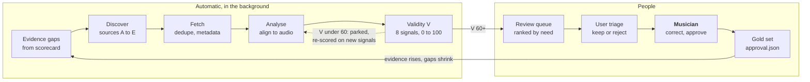

# Audio Reverse Engineering: Gold Data Sourcing

As of 2026-10-18 · Owner: Antanas · Status: living document. Changes go through pull requests. Requirement: FR-16 in the [PRD](prd.md).

A background worker searches for music and sheet music that the scorecard is missing, checks each candidate against its audio, and gives it a validity score. The most promising candidates are surfaced for the user to triage and for an approved musician to correct and approve. Nothing becomes gold without that approval.

The loop runs continuously: every approval raises evidence in the scorecard, and the next search targets whatever gap is then the largest.

## What to look for

The search is driven by demand. The scorecard knows which evidence sets fall short of what is needed, and the sourcing worker fills the biggest gap first. It doesn't collect music for its own sake.

| Evidence set | Need per language | EN today | LT today | Each candidate must carry |
| --- | --- | --- | --- | --- |
| Songs with melody and word-timed lyrics | 8, across ≥ 2 genres | 0 | 3 approved | Audio + notated vocal line or MIDI + lyrics (timed if possible) |
| Songs with sections and chords | 5 | 0 | 0 | Audio + chord chart or lead sheet |
| Clips per instrument family (shared) | 3 each for piano, guitar, bass, drums, synth, SFX | 0 | — | Isolated or clearly audible part + score, TAB, MIDI or hit annotations |
| Walkthrough songs | 2 | 0 | 0 | Any real song, 2–5 min |

**Priority order.** The worker ranks open gaps by need × (1 − coverage), so whatever is furthest behind is searched first. Within a gap it aims for spread: genres, tempos, singer voice types and recording quality.

## Sources

Sources come in tiers by how much we trust them before checking. Each source gets an adapter with its own rate limit, and its terms and licence are recorded at onboarding. The user carries legal responsibility, but the record still shows where every file came from.

| Tier | Source | Gives us | Languages | Best for |
| --- | --- | --- | --- | --- |
| A: curated research datasets | MAESTRO, MusicNet | Audio with aligned notes | Instrumental | Piano clips |
| A | GuitarSet, IDMT-SMT (guitar, bass, drums), ENST-Drums, E-GMD | Audio with note, string/fret or hit annotations | Instrumental | Guitar, bass and drum clips |
| A | MedleyDB, MUSDB18, Slakh2100 | Multitrack stems (Slakh: rendered from MIDI, so exactly aligned) | Mostly EN | Separation, synth and SFX clips |
| A | DALI, JamendoLyrics | Word- or line-aligned lyrics to audio | EN (JamendoLyrics also FR, DE, ES) | Voice, EN |
| B: open score and lyric libraries | IMSLP, Mutopia, OpenScore | Public-domain and CC scores | Mixed; some LT | Melody and piano clips |
| B | LRCLIB | Time-synced lyric lines for commercial songs | EN, LT and others | Line timing for voice songs |
| B | MusicBrainz + AcoustID | Identity, duration, release metadata, audio fingerprints | All | Matching audio to scores and lyrics |
| B | Jamendo, Free Music Archive, Internet Archive | Creative Commons audio | EN, some LT | Audio for walkthrough and lyric songs |
| C: Lithuanian archives | Folklore and music archives, songbooks, the Lithuanian Music Information Centre (MIC.lt) | Notated melodies with lyrics, recordings | LT | Voice, LT (access terms to be checked per archive) |
| D: community | MuseScore community scores, Ultimate Guitar-style TAB, user-uploaded MIDI | Scores and TAB for popular songs, quality varies | All | Guitar and pop songs, only with strong agreement signals |
| E: our own | Commissioned scores from approved musicians; the user's own files | Reference scores and timed lyrics made to order | EN, LT | Filling gaps no source covers |

Tier A and B items still need musician approval before they count fully, but they arrive as strong candidates. Tier D only enters the review queue when several signals agree (next section). For Lithuanian, tiers C and E are likely to supply most of the gold set.

## Validity signals

Every candidate gets a **validity score V** from 0 to 100 before a person sees it. V estimates how likely the reference is to be correct for this audio. It ranks the review queue; it never replaces approval.

$$
V = \left\lfloor 100 \cdot \frac{\sum_s w_s\, n_s}{\sum_s w_s} \right\rfloor, \quad V = 0 \text{ on any hard reject}
$$

Signals that don't apply (lyrics fit for a drum clip, for example) are left out of the mean, as in the scorecard.

| Signal | How it is measured | n = 1 when | Weight |
| --- | --- | --- | --- |
| Audio–score alignment | Render the score or MIDI, align it to the recording with chroma DTW; check coverage, cost, key and tempo | ≥ 95% of the recording aligned, low cost, same key and tempo | 25 |
| Cross-source agreement | Compare independent references: note F-measure between scores, chord match, lyric character edit distance | ≥ 2 independent sources agree within tolerance | 20 |
| Source tier | Prior trust in the source | Tier A (A 1.0, E 0.9, B 0.75, C 0.7, D 0.4) | 15 |
| Identity match | AcoustID fingerprint, MusicBrainz metadata, duration | Fingerprint match and duration within 2% | 10 |
| Lyrics fit | Language detected on the vocal stem; syllables vs vocal notes; timed lines vs vocal onsets | Right language, syllable count within 5%, lines within 300 ms | 10 |
| Structural sanity | Parses; ranges playable; meter consistent; TAB playable; drum map valid | No violations | 10 |
| Community signal | Ratings, downloads, “official” flags where a source has them | Top decile of its source | 5 |
| Our pipeline agrees | Our own transcription vs the candidate | Note F ≥ 0.8 | 5 |

**Hard rejects** (V = 0, kept with the reason): duplicate fingerprint, unreadable file, wrong language for the gap, under 20 s, or a reference that covers less than half of the audio.

| V | What happens |
| --- | --- |
| 0–59 | Parked with its reasons; re-scored when new signals arrive (a second source, better alignment) |
| 60–84 | Enters the review queue |
| 85–100 | Enters the review queue at the top, and counts as provisional (unapproved) evidence in the scorecard until reviewed |

Our own pipeline's agreement carries little weight on purpose. If it counted heavily, the gold set would fill up with songs the app already gets right, and scores would look better than they are.

## Background processing

A sourcing worker in `apps/remix_studio/sourcing/` runs on the workstation without blocking anything else. Each stage is resumable and records its output, so a crash or reboot loses no work.

| Stage | What it does | Writes |
| --- | --- | --- |
| 1. Plan | Reads scorecard gaps and turns them into search tasks (“LT, voice, folk, female singer, 2 more needed”) | Task list |
| 2. Discover | Queries source adapters (APIs, dataset indexes, archive catalogues) | Candidate stubs with source, URL and metadata |
| 3. Fetch | Downloads audio and references within per-source rate limits; checks file type and length | Files + SHA-256 under `data/remix/sourcing/<candidate>/` |
| 4. Identify | Fingerprints the audio (AcoustID) and drops duplicates; fills metadata from MusicBrainz | Identity record |
| 5. Analyse | Runs separation, pitch and STT on the audio; renders the reference; aligns the two in batches ([alignment.md](alignment.md)) | Alignment, stems, transcripts |
| 6. Score | Computes every signal and V; applies hard rejects | `candidate.json` with signals, V and reasons |
| 7. Queue | Puts V ≥ 60 in the review queue, ranked by gap priority × V | Queue entry |
| 8. Promote | On approval, copies the item into the gold set with its `approval.json`; on rejection, records why | Gold item or rejection record |

**Running rules**

- **Yields to the user.** The GPU stages pause while the user has a job running in the studio, and resume afterwards.
- **Polite fetching.** Each source has a rate limit, caches responses, and gets an adapter that respects its terms. A blocked or failing source is skipped and reported, not hammered.
- **Budgets.** Disk (proposed 50 GB under `data/remix/sourcing/`) and cloud STT spend per day are capped. The worker stops a stage when a cap is reached, and says so in the report.
- **Re-scoring.** When a new signal arrives (a second source for the same song, a better aligner), affected candidates are re-scored automatically.
- **Paths and storage.** All locations come from `studio_paths.py`; candidates and signals are also recorded in the SQLite catalog (`candidates`, `candidate_signals`).

## Review surface

Candidates surface in a **Candidates** area of the studio. The user triages them, and an approved musician makes the final call. These are actions to agree on, like the DoD's user actions.

| ID | Who | Can… | Done when | Priority | Status |
| --- | --- | --- | --- | --- | --- |
| R1 | User | See a candidates inbox ranked by gap and V | Filters by language, family, source, V and stage; the top row is always the most useful next review | Must | Proposed |
| R2 | User, musician | Open a candidate and compare it with the audio | Audio plays with the reference in its family's notation and lyrics highlighted, synced; an alignment strip marks where reference and audio disagree | Must | Proposed |
| R3 | User, musician | See why it scored what it did | V broken down by signal with a plain reason each; source, licence and fetch date shown | Must | Proposed |
| R4 | User | Triage quickly | Shortlist, reject with a reason, or ask for more sources, each with one key; the next candidate opens at once | Must | Proposed |
| R5 | User | Send shortlisted items to a musician | Assign a reviewer by language and instrument; the musician sees a personal queue | Must | Proposed |
| R6 | Musician | Correct the reference in place | Notes, chords, lyrics and timings are editable with the same editor as V11; corrections are recorded under the musician's name | Must | Proposed |
| R7 | Musician | Approve or reject, with scope | Approval covers notes, lyrics, timing and/or chords; it writes `approval.json`; any later change to the files voids it | Must | Proposed |
| R8 | User | Ask the system to find references for a specific song | Paste a title, URL or file; the worker searches and reports what it found within the run | Should | Proposed |
| R9 | User | See sourcing progress | Gaps per language and family, candidates per stage, budgets used, sources failing | Must | Proposed |
| R10 | User | Manage the approved musicians list | Add or remove a musician and set what they may approve (language, instruments) | Must | Proposed |

## Safeguards

- **No circular proof.** Our pipeline's agreement is worth 5 of 100 in V. At least a third of each gold set must be songs where our pipeline disagreed with the reference before review, so the set includes hard cases.
- **Held out from training.** Gold items, and candidates in review, are never used to train or tune models. Their checksums go into a held-out list that every training script checks.
- **Spread, not volume.** Each gold set has minimum spread: ≥ 2 genres, both male and female singers for voice, and studio as well as live or home recordings. The planner won't over-fill one corner.
- **Provenance end to end.** Every gold item can be traced back to source URL, fetch date, licence field, the signals at review, and the reviewer.
- **Independent sources mean independent.** Two community uploads copied from each other count as one source. Matching file hashes or near-identical engraving collapse into a single source.
- **Legal responsibility** stays with the user, as decided. The worker still records each source's terms so the user can decide what to keep.

## Changes to the scorecard

While gold data is scarce, the score mostly tracks how far the musicians have got rather than how good the engineering is. Two changes make both kinds of progress visible.

1. **Quality and evidence are shown as their own numbers.** The report shows Q (0–100), E (0–100) and the score side by side for every deliverable and language. Engineering progress shows in Q from the first run, measured on whatever items exist, approved or not. The score itself still needs evidence.
2. **What counts as unapproved evidence (U).** Only unreviewed candidates with V ≥ 85 count at half weight. Candidates below 85, and parked ones, count for nothing. The three existing Lithuanian songs were provided and approved by musicians, so they count fully as gold.

The scoring formula itself doesn't change.

## Done when

Sourcing is a deliverable in its own right (FR-16 in the PRD) and is scored like every other.

- [ ] The worker runs unattended for 7 days, and survives a reboot without losing work or refetching
- [ ] Every open gap in EN and LT has at least 3 candidates with V ≥ 60 in the queue
- [ ] V is calibrated: at least 80% of candidates with V ≥ 85 are approved by musicians, measured over the first 50 reviews
- [ ] R1–R7, R9 and R10 pass their walkthroughs
- [ ] Every gold item traces back to its source, signals and reviewer
- [ ] The scorecard report shows Q, E and the score separately

## Open questions

- [ ] Which sources to switch on first? Some need accounts or API keys (AcoustID, Jamendo, cloud STT).
- [ ] Budgets: disk for `data/remix/sourcing/` (proposed 50 GB) and daily cloud spend.
- [ ] Who are the first approved musicians for EN and for LT, and how are they paid or credited?
- [ ] Should tier D community sources (MuseScore, TAB sites) be used at all, or only tiers A–C and E?
- [ ] Which Lithuanian archives will give access, and on what terms?
