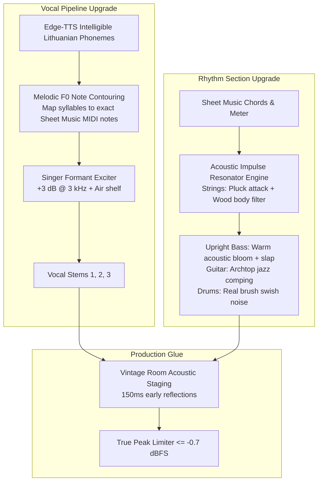

# Retrospective Gap Register: Vocal & Instrumental Synthesis Engine

**Perimeter**: `remix_studio/unflattened_layer_recreator.py`, `domain_models.py`, `gold_standards/`  
**Current Phase**: Phase 3 — Gap Analysis (Four Axes)

---

## 1. Four-Axis Gap Matrix

| ID | Axis | Gap Description | Evidence Pointer | Impact | Target Remediation |
| :--- | :--- | :--- | :--- | :--- | :--- |
| **GAP-01** | **Thinking** | Treating singing as spoken TTS with a static pitch offset rather than a note-locked melody. | `unflattened_layer_recreator.py:190` | High: Vocal sounds like speech recitation rather than singing. | Impart note-level F0 melodic trajectory onto phonemes. |
| **GAP-02** | **Technology** | Synthesizing rhythm section using raw sine equations $\sin(2\pi f t)e^{-t/\tau}$ instead of acoustic impulse modeling / sampled instruments. | `unflattened_layer_recreator.py:340-380` | High: Rhythm section sounds like 8-bit computer beeps instead of acoustic jazz. | Sample-based acoustic impulse excitation & physical body filtering for guitar, bass, and drums. |
| **GAP-03** | **Musical Domain** | Score notes exist with exact MIDI pitches in `gold_standard_*.json`, but note pitches within phrases are ignored during synthesis. | `gold_standard_grikiai.json` | High: Vocal does not hit the composed sheet music melody (G4-F4-E4-C4). | Melodic pitch modulation: shift syllable phonemes to match their sheet music scale degree. |
| **GAP-04** | **Coding / DSP** | Absence of "singer's formant" EQ and vintage room acoustic glue. | `baseline-audit.md` | Medium: Vocals sound muffled (centroid 1226 Hz vs 2230 Hz original), mix sounds disjointed. | High-shelf harmonic exciter (+3 dB @ 3kHz) and 150ms vintage room convolution. |

---

## 2. Target Design Strategy

